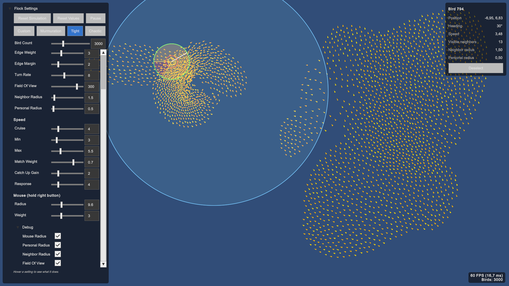

# Flocking2D



**[Play it in the browser on itch.io](https://osvak.itch.io/flocking2d)** (a Windows build is there too)

A 2D bird flocking simulation made in Unity using DOTS (Entities, Jobs and Burst). It's based on the classic boids idea: each bird only looks at the birds around it, and the flock shape comes out of that.

It runs up to 10,000 birds. Birds are colored by speed, red when slower than cruise speed and yellow when faster.

Made with Unity 6000.6.5f1 and URP.

## Running it

Open the `Flocking2D` folder in Unity Hub, open `Assets/Scenes/MainScene` and press Play.

## Builds

- **Browser (HTML5)**: runs on a single thread, because browsers limit multithreading. Good for a quick look.
- **Windows**: uses all CPU cores. Use this one for the highest bird counts.

Both are on the [itch.io page](https://osvak.itch.io/flocking2d).

## Controls

- **Left click** a bird to select it. A panel shows its position, heading, speed and how many neighbors it sees, and the debug circles are drawn around it.
- **Hold right click** to pull nearby birds toward the cursor.
- **Settings panel** on the left to change values while it runs. Hover a setting to see what it does.
  - Reset Simulation respawns the birds using the Bird Count slider.
  - Reset Values puts the sliders back to the scene values.
  - Pause stops and resumes the simulation.

## How the birds behave

Every frame each bird finds its 16 closest neighbors and steers using these rules:

- **Alignment**: turn to face the same way as the neighbors it can see.
- **Cohesion**: steer toward the middle of the neighbors it can see.
- **Separation**: steer away from birds that are too close. This works in every direction, not only inside the view angle.
- **Edges**: turn back when getting close to the edge of the screen.
- **Speed**: each bird has a cruise speed. It matches its neighbors' speed a bit, speeds up when it's behind the group, slows down when it's ahead, and brakes if another bird is too close in front.

A bird only "sees" neighbors inside its neighbor radius and its field of view.

## Presets

| Preset | What it looks like |
|---|---|
| Custom | Your own values. Moving a slider switches to this. |
| Murmuration | Big groups that split and merge. |
| Tight | Tight groups that stay together. |
| Chaotic | Fast birds in loose groups. |

## Parameters

Default values are the ones the scene starts with (Custom).

### Steering

| Parameter | Default | What it does |
|---|---|---|
| Alignment | 1 | How hard birds turn to match their neighbors' heading. |
| Separation | 1.5 | How hard birds avoid each other inside the personal radius. |
| Cohesion | 1 | How hard birds are pulled toward the middle of their neighbors. |
| Edge Weight | 3 | How hard birds turn back at the screen edge. |
| Edge Margin | 2 | How far from the edge birds start turning back. |
| Turn Rate | 4 | How fast birds can turn. |
| Field Of View | 240 | View angle in degrees. 360 sees all around. |
| Neighbor Radius | 1.5 | How far a bird can see its neighbors. |
| Personal Radius | 0.4 | Birds closer than this push each other away. |

### Speed

| Parameter | Default | What it does |
|---|---|---|
| Cruise | 3 | Speed a bird flies at on its own. |
| Min | 1.5 | Slowest a bird can fly. |
| Max | 4.5 | Fastest a bird can fly. |
| Match Weight | 0.5 | 0 ignores neighbor speed, 1 copies it. |
| Catch Up Gain | 2 | Speed up when behind the group, slow down when ahead. |
| Response | 3 | How fast birds change speed. |

### Mouse

| Parameter | Default | What it does |
|---|---|---|
| Radius | 3 | Birds inside this radius get pulled to the cursor. |
| Weight | 3 | How hard the cursor pulls. |

### Debug

Toggles for drawing the mouse radius and, for the selected bird, its personal radius, neighbor radius and field of view.

## How it's built

- **ECS**: every bird is an entity, so there's no GameObject per bird.
- **Jobs + Burst**: neighbor search and movement run as parallel jobs.
- **Spatial hash grid**: birds are sorted into grid cells, and each bird searches outward ring by ring until it has its 16 nearest neighbors. The grid uses an adaptive cell size.
- **GPU instancing**: birds are drawn in instanced batches with a custom shader that colors them by speed.
- **Frame-rate independent easing**: turning and speed changes behave the same at any frame rate.
- **UI Toolkit** for the panels and debug drawing, and the **Input System** for the mouse controls.

## Project layout

```
Assets/Scripts/Runtime/
  DOTS/Authorings   bakers for birds, spawner and config
  DOTS/Components   ECS components
  DOTS/Systems      spawning, neighbor search, movement, reset
  Rendering         instanced bird drawing and shader
  UI                settings panel, bird selection, FPS counter
```
